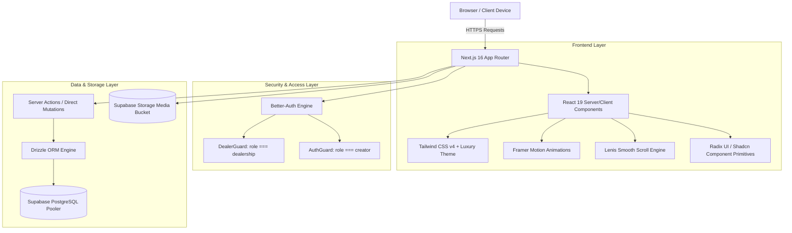

# CARPAIGN — Technical & Feature Documentation Hub

> **"Transforming Automotive Inventory into Content, and Content into Sales."**

Selamat datang di pusat dokumentasi teknis dan arsitektur fitur platform **CARPAIGN**. Repositori ini merupakan implementasi purwarupa fungsional (*Minimum Viable Product / MVP*) dari sistem **Vertical SaaS-Enabled Marketplace** yang menghubungkan inventaris fisik dealer otomotif secara langsung dengan ekosistem kreator konten video pendek (*Clip, UGC, dan Shoot*).

Dokumentasi ini disusun secara terstruktur berdasarkan prinsip **Diátaxis Framework** (Tutorials, How-to Guides, Technical Reference, dan Architectural Explanation) untuk memberikan pemahaman menyeluruh mengenai implementasi kode, alur data (*flow*), rancangan basis data, hingga mekanisme bisnis.

---

## 🗺️ Panduan Navigasi Dokumentasi

Seluruh dokumentasi teknis terbagi ke dalam 6 dokumen spesialis di dalam folder [`docs/`](file:///Users/bangjhener/Desktop/Lomba/ADIKARA%202026/Entre/carpaign/docs):

| No | Dokumen | Fokus Bahasan | File Link |
| :-: | :--- | :--- | :--- |
| **01** | **Arsitektur & Tech Stack** | Arsitektur Next.js 16, App Router, Server Components, Better-Auth, Dual-Guard Role (`dealership` & `creator`), dan Alur Data. | [`architecture-and-tech-stack.md`](file:///Users/bangjhener/Desktop/Lomba/ADIKARA%202026/Entre/carpaign/docs/architecture-and-tech-stack.md) |
| **02** | **Skema Basis Data & Model Data** | ERD Mermaid, Drizzle ORM, PostgreSQL Supabase, kamus tabel (`user`, `campaigns`, `vehicles`, `dealer_profiles`, `creator_profiles`). | [`database-and-data-models.md`](file:///Users/bangjhener/Desktop/Lomba/ADIKARA%202026/Entre/carpaign/docs/database-and-data-models.md) |
| **03** | **Fitur Portal Dealer (B2B)** | Dashboard Dealer, Manajemen Inventaris Mobil, Wizard 4-Tahap Campaign (Clipping, UGC, Videography), Review Submisi & Escrow, serta Billing. | [`features-dealer-portal.md`](file:///Users/bangjhener/Desktop/Lomba/ADIKARA%202026/Entre/carpaign/docs/features-dealer-portal.md) |
| **04** | **Fitur Portal Kreator (B2C)** | Dashboard Kreator, Marketplace Campaign, Pelamaran Job, Analitik Kinerja, Dompet & Pencairan Dana, Leaderboard, serta Sistem Tier V4–V12. | [`features-creator-portal.md`](file:///Users/bangjhener/Desktop/Lomba/ADIKARA%202026/Entre/carpaign/docs/features-creator-portal.md) |
| **05** | **Atribusi & Tracking Closed-Loop** | Mekanisme tautan unik `/c/[ref]`, pelacakan calon pembeli WhatsApp API, parameter pelacakan prospek, dan kalkulasi CPL/CPA. | [`attribution-and-tracking.md`](file:///Users/bangjhener/Desktop/Lomba/ADIKARA%202026/Entre/carpaign/docs/attribution-and-tracking.md) |
| **06** | **Landing Page & Sistem Desain** | Tema Dark Cinematic Luxury Gold, Framer Motion, Lenis Smooth Scrolling, Glassmorphism, dan panduan komponen UI. | [`landing-page-and-design-system.md`](file:///Users/bangjhener/Desktop/Lomba/ADIKARA%202026/Entre/carpaign/docs/landing-page-and-design-system.md) |
| **07** | **Visual Prompting Guide (AI Image)** | Konteks ringkas proyek & design system siap salin untuk Midjourney, DALL-E 3, Flux (Dashboard, Mobile, Hero, Infografis). | [`ai-image-generation-context.md`](file:///Users/bangjhener/Desktop/Lomba/ADIKARA%202026/Entre/carpaign/docs/ai-image-generation-context.md) |

---

## 🏗️ Ringkasan Ekosistem Teknologi (*Tech Stack*)



### Spesifikasi Inti Platform:
* **Framework**: Next.js 16.0+ (App Router, Server Actions, Dynamic Metadata).
* **UI Library**: React 19, Tailwind CSS v4, Radix UI Primitives via *shadcn/ui*.
* **Animasi**: Framer Motion 12+, `@studio-freight/lenis` smooth scrolling.
* **Autentikasi**: `better-auth` v1.1+ (Email-Password, Multi-Session, Cookie-based, Role-Based Access Control).
* **Database & ORM**: PostgreSQL via Supabase Connection Pooling (Transaction Mode port 6543) dengan Drizzle ORM v0.40+.
* **Penyimpanan Media**: Supabase Storage bucket untuk cover mobil, avatar kreator, dan draf aset.

---

## 👥 Dua Peran Utama Pengguna (*Dual Persona*)

Sistem CARPAIGN dirancang sebagai **Two-Sided Marketplace**:

1. **Dealership / Showroom Otomotif (`role: "dealership"`)**:
   * Masuk melalui Portal Dealer (`/dealer/*`).
   * Mengelola unit mobil bekas yang tersedia di showroom fisik.
   * Menerbitkan kampanye pemasaran modular (Clip, UGC, Shoot) dengan alokasi bujet terprogram.
   * Memverifikasi draf video dari kreator dan menyetujui pelepasan dana *escrow*.
   * Mengisi saldo dompet (*Top Up*) via Virtual Account.

2. **Kreator Konten Video (`role: "creator"`)**:
   * Masuk melalui Portal Kreator (`/creator/*` atau rute utama `/campaigns`, `/analitik`, `/pendapatan`).
   * Menjelajahi katalog lowongan kampanye mobil dan mengajukan diri (*apply*).
   * Mengunggah bukti submisi video dan memantau jumlah tayangan (*views*).
   * Menarik penghasilan (*withdraw*) ke rekening bank lokal.
   * Meningkatkan peringkat tier mesin otomotif (**V4 Class** $\rightarrow$ **V12 Class**) untuk memangkas komisi potongan platform.

---

## 🚀 Memulai Pengembangan Lokal (*Quick Start*)

```bash
# 1. Pastikan dependensi terpasang
npm install

# 2. Siapkan variabel lingkungan pada .env
DATABASE_URL="postgresql://postgres:[PASSWORD]@[HOST]:6543/postgres"
BETTER_AUTH_SECRET="your-auth-secret-key"
NEXT_PUBLIC_SUPABASE_URL="https://your-project.supabase.co"
NEXT_PUBLIC_SUPABASE_ANON_KEY="your-anon-key"

# 3. Jalankan migrasi schema Drizzle
npx drizzle-kit push

# 4. Jalankan dev server
npm run dev
```

Buka peramban di [http://localhost:3000](http://localhost:3000). Rute publik akan menampilkan Landing Page sinematik, sedangkan `/login` dan `/register` menyediakan gerbang masuk ke dashboard.

