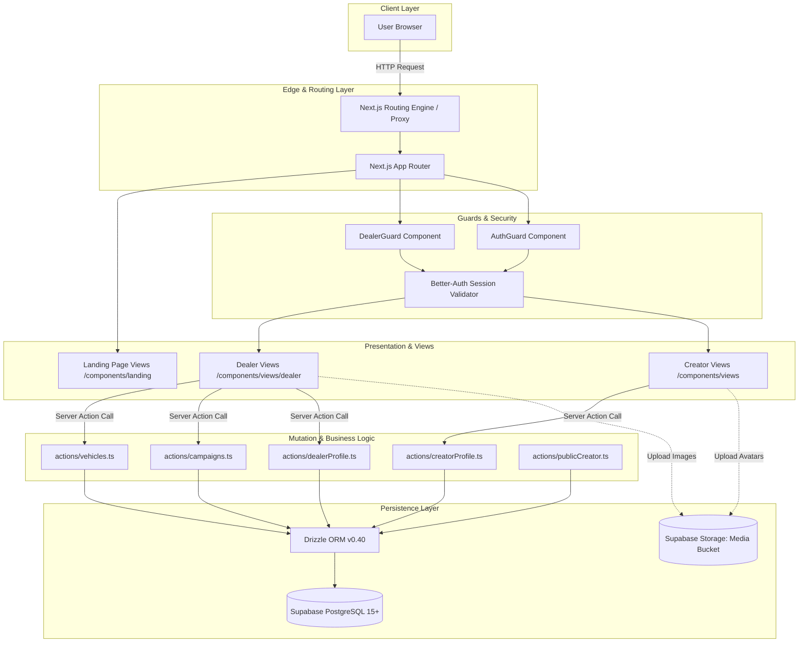
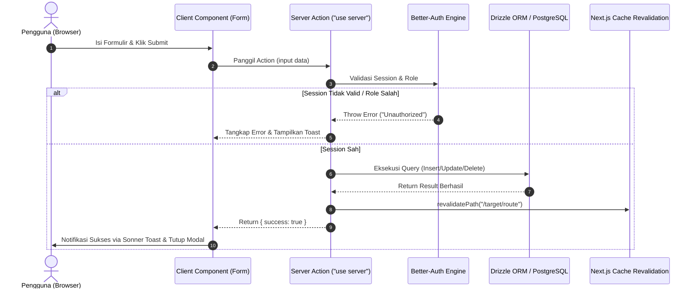

# Arsitektur Sistem & Spesifikasi Tech Stack

Dokumen ini menjelaskan rancangan arsitektur perangkat lunak, pola aliran data, sistem kontrol akses berbasis peran (*Role-Based Access Control / RBAC*), dan spesifikasi pustaka yang menopang platform **CARPAIGN**.

---

## 1. Topologi Arsitektur Aplikasi

CARPAIGN dibangun di atas arsitektur monolitik modern berbasis **Next.js 16 (App Router)** yang menggabungkan kapabilitas *Server-Side Rendering (SSR)*, *React Server Components (RSC)*, dan *Server Actions* untuk mutasi data yang aman dan efisien.



---

## 2. Struktur Rute & Direktori (*Routing Map*)

Struktur folder mengadopsi standar Next.js 16 App Router dengan isolasi rute yang jelas:

```text
src/
├── app/
│   ├── (auth)/                  # Rute otentikasi (Route Group tanpa prefix URL)
│   │   ├── login/page.tsx       # Halaman Masuk Akun
│   │   └── register/page.tsx    # Halaman Registrasi (Pilihan Peran: Dealer / Kreator)
│   ├── api/
│   │   └── auth/[...all]/       # Endpoint API Handler Better-Auth (/api/auth/*)
│   ├── c/
│   │   └── [ref]/page.tsx       # Rute Publik Atribusi & Profil Kreator (/c/:ref)
│   ├── dealer/                  # Portal Khusus Showroom Otomotif
│   │   ├── dashboard/page.tsx   # Metrik ringkasan performa dealer
│   │   ├── inventory/page.tsx   # CRUD Inventaris Mobil Bekas
│   │   ├── campaigns/page.tsx   # Wizard Pembuatan & Monitoring Campaign
│   │   ├── submissions/page.tsx # Review Video Masuk & Approval Escrow
│   │   ├── billing/page.tsx     # Dompet Dealer, Top-Up & Riwayat Transaksi
│   │   ├── profile/page.tsx     # Profil Usaha Dealer & Alamat Showroom
│   │   ├── bantuan/page.tsx     # Pusat Layanan Showroom
│   │   ├── faq/page.tsx         # Tanya Jawab Dealer
│   │   └── layout.tsx           # Layout Dealer terproteksi DealerGuard
│   ├── creator/                 # Portal Khusus Kreator Video
│   │   ├── dashboard/page.tsx   # Metrik views, saldo, & job aktif
│   │   ├── campaigns/page.tsx   # Katalog Eksplorasi Lowongan Campaign
│   │   ├── analitik/page.tsx    # Grafik views & sebaran platform
│   │   ├── pendapatan/page.tsx  # Dompet Kreator & Modal Penarikan Saldo
│   │   ├── leaderboard/page.tsx # Peringkat kreator & clipper
│   │   ├── rank-rewards/page.tsx# Sistem Tier Mesin (V4 s.d. V12)
│   │   ├── profile/page.tsx     # Pengaturan portofolio & akun bank
│   │   └── layout.tsx           # Layout Kreator terproteksi AuthGuard
│   ├── page.tsx                 # Landing Page Utama Publik
│   └── layout.tsx               # Root Layout (Font, Theme, Sonner Toast)
├── components/
│   ├── auth/                    # Komponen pelindung rute (Guards)
│   ├── landing/                 # Seksi-seksi eksklusif Landing Page
│   ├── layout/                  # Navigasi (Sidebar, Header, Topbar Glassmorphism)
│   ├── modals/                  # Dialog popup (TopUpModal, WithdrawModal, ApplyJobModal)
│   ├── ui/                      # Komponen atomik Shadcn / Radix UI
│   └── views/                   # View utama halaman (Client & Server Components)
├── db/                          # Konfigurasi Drizzle ORM, Schema, dan Seed
└── lib/                         # Client Better-Auth, Supabase, dan Utility
```

---

## 3. Sistem Keamanan & Kontrol Akses (*Role-Based Access Control*)

Otentikasi ditangani oleh **`better-auth`**, sebuah pustaka otentikasi mutakhir yang menyimpan sesi pengguna di database PostgreSQL (`session` table) dan memvalidasi cookie sesi secara terenkripsi.

### Peran Pengguna (*Roles*)
Di dalam skema basis data (`src/db/auth-schema.ts`), kolom `role` pada tabel `user` menampung dua jenis nilai:
* `"dealership"`: Pengguna berhak mengakses seluruh rute `/dealer/*`.
* `"creator"`: Pengguna berhak mengakses seluruh rute `/creator/*` atau rute kreator publik.

### Implementasi Guards
Untuk mencegah akses rute tak berizin secara *client-side*, aplikasi mengimplementasikan dua komponen pembungkus:

1. **`DealerGuard` (`src/components/auth/DealerGuard.tsx`)**:
   ```typescript
   export function DealerGuard({ children }: { children: React.ReactNode }) {
     const { data: session, isPending } = authClient.useSession();
     const router = useRouter();

     useEffect(() => {
       if (!isPending) {
         if (!session) {
           router.replace("/login");
         } else if (session.user.role !== "dealership") {
           // Jika kreator mencoba mengakses portal dealer, alihkan ke dashboard kreator
           router.replace("/dashboard");
         }
       }
     }, [session, isPending, router]);

     if (isPending || !session || session.user.role !== "dealership") {
       return <PageLoader message="Memverifikasi akses dealer..." />;
     }

     return <>{children}</>;
   }
   ```

2. **`AuthGuard` (`src/components/auth/AuthGuard.tsx`)**:
   * Memastikan pengguna memiliki sesi aktif sebelum merender rute kreator. Jika pengguna ber-role `dealership` mengakses rute kreator, sistem secara cerdas memberikan akses kontekstual atau mengarahkan ke dashboard yang relevan.

---

## 4. Mekanisme Mutasi Data (*Server Actions*)

Aplikasi sepenuhnya menghindari endpoint REST API konvensional untuk operasi internal dengan mengadopsi **Next.js Server Actions**. Pendekatan ini mengeliminasi *boilerplate* API route, menjamin keamanan eksekusi langsung di server, serta mengizinkan revalidasi cache secara otomatis via `revalidatePath`.

### Standar Pola Mutasi Server Action:


---

## 5. UI/UX, Animasi, & Sistem Desain

* **Tailwind CSS v4**: Menggunakan variabel tema kustom bernuansa *Luxury Gold & Dark Carbon* (`--primary`, `--primary-glow`, `--bg-luxury-black`).
* **Framer Motion**: Seluruh transisi halaman, kemunculan kartu (*staggered fade-up*), modal *pop-in*, dan pergantian tab menggunakan motion variants dengan timing kurva cubic-bezier `[0.16, 1, 0.3, 1]`.
* **Lenis Smooth Scroll**: Memberikan pengalaman navigasi kelas editorial Awwwards pada Landing Page tanpa lag perangkat keras.
* **Kompresi Gambar Sisi Klien (`src/lib/image-compression.ts`)**: Sebelum berkas foto mobil atau bukti submisi diunggah, peramban secara otomatis mengompresi gambar ke resolusi optimal (maksimal 1600px, kualitas 0.82) menggunakan HTML Canvas API untuk menghemat kuota transmisi dan penyimpanan database.

