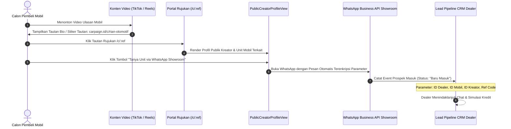
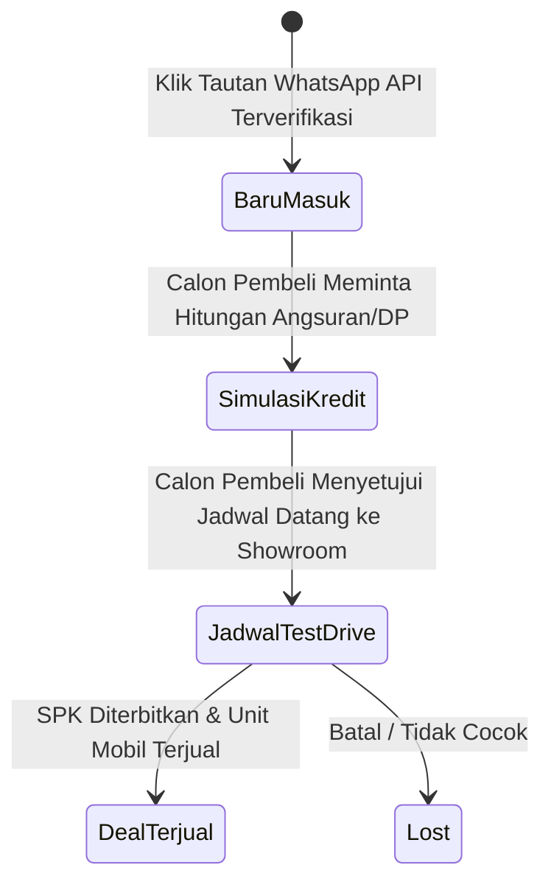

# Atribusi & Pelacakan Calon Pembeli (Closed-Loop Attribution Engine)

Dokumen ini menjelaskan implementasi teknis dari **Closed-Loop Attribution Engine**, salah satu pilar inovasi paling penting dalam platform **CARPAIGN** yang menghubungkan penayangan konten video di media sosial dengan percakapan calon pembeli riil pada saluran WhatsApp showroom mobil.

---

## 1. Masalah yang Diselesaikan: Mengakhiri Jebakan *Vanity Metrics*

Pada model promosi otomotif konvensional, pemilik dealer sering kali membayar jutaan rupiah kepada agensi atau kreator yang hanya melaporkan jumlah tayangan (*views*) atau tanda suka (*likes*). Namun, pemilik showroom tidak pernah tahu:
* Apakah penonton tersebut merupakan calon pembeli lokal yang potensial?
* Berapa banyak orang yang benar-benar menghubungi showroom setelah menonton video tersebut?
* Berapa biaya riil untuk mendapatkan 1 calon pembeli (*Cost per Lead / CPL*)?

CARPAIGN memecahkan masalah ini dengan merancang rantai atribusi tertutup (*closed-loop pipeline*).

---

## 2. Alur Kerja Atribusi Tertutup (*Closed-Loop Flow*)



---

## 3. Implementasi Kode Rute Publik (`src/app/c/[ref]/page.tsx`)

Rute `/c/[ref]` bertindak sebagai gerbang publik (*landing page perantara*) yang ringan, cepat dimuat pada perangkat seluler, serta dilengkapi metadata dinamis untuk kartu OpenGraph di media sosial:

```typescript
// src/app/c/[ref]/page.tsx
export async function generateMetadata({ params }: Props): Promise<Metadata> {
  const { ref } = await params;
  const profile = await getPublicCreatorByRef(ref);

  if (!profile) return { title: "Kreator tidak ditemukan — Carpaign" };

  const name = profile.fullName ?? profile.username ?? "Kreator";
  return {
    title: `${name} — Profil Kreator Otomotif | Carpaign`,
    description: profile.bio ?? `Lihat profil kreator otomotif ${name} di platform Carpaign.`,
    openGraph: {
      title: `${name} — Kreator Otomotif | Carpaign`,
      description: profile.bio ?? `Profil ulasan otomotif terverifikasi.`,
      images: profile.avatarImage ? [{ url: profile.avatarImage }] : [],
    },
  };
}
```

### Server Action Pencarian Referal (`src/app/actions/publicCreator.ts`):
Mengambil profil kreator berdasarkan kode unik referal:
```typescript
export async function getPublicCreatorByRef(ref: string) {
  return await db.query.creatorProfiles.findFirst({
    where: eq(creatorProfiles.referralCode, ref),
    with: { user: true },
  });
}
```

---

## 4. Format Parameter Pesan WhatsApp API

Saat calon pembeli menekan tombol kontak di halaman profil rujukan, sistem mengonstruksi tautan dinamis yang mengarahkan ke nomor WhatsApp resmi dealer dengan pesan terformat:

$$\text{Tautan WhatsApp API} = \text{https://api.whatsapp.com/send?phone=}[\text{NomorShowroom}]\&text=[\text{PesanTerenkripsi}]$$

### Contoh Konstruksi Pesan Teks Otomatis:
```text
Halo Maju Jaya Motor, saya tertarik dengan unit Honda HR-V RS 2023 yang diulas oleh Rian Otomotif di Carpaign. Apakah unit masih tersedia untuk dijadwalkan test drive?

(Ref Tracking: CRF-8921-HRV | Creator ID: usr_rian21 | Campaign: CMP-004)
```

Dengan parameter tersebut:
1. Wiraniaga (*sales showroom*) langsung mengetahui kendaraan apa yang diminati calon pembeli tanpa perlu bertanya ulang.
2. Sistem mencatat bahwa interaksi tersebut berasal dari kampanye dan kreator tertentu.

---

## 5. Saluran Prospek Dealer (*Lead Pipeline CRM*)

Di dalam dashboard dealer, seluruh interaksi yang masuk melalui tautan atribusi diklasifikasikan ke dalam 4 tahapan konversi (*Lead Pipeline Stages*):



1. **Baru Masuk (*Inbound Inquiry*)**: Calon pembeli baru pertama kali mengirim pesan melalui WhatsApp API.
2. **Simulasi Kredit (*Financing Discussion*)**: Wiraniaga mengirimkan rincian tabel angsuran atau negosiasi harga tunai.
3. **Jadwal Test Drive (*Showroom Visit*)**: Calon pembeli mengonfirmasi tanggal kedatangan langsung ke lokasi showroom.
4. **Deal Terjual (*Closed-Won Deal*)**: Terbit Surat Pesanan Kendaraan (SPK) dan unit mobil resmi keluar dari inventaris.

---

## 6. Formulasi Metrik Finansial Promosi (CPL, CPA, ROMI)

Melalui integrasi data antara bujet kampanye dan saluran prospek, dashboard CARPAIGN secara otomatis menghitung tiga metrik efisiensi pemasaran utama bagi pemilik showroom:

### 1. *Cost per Lead* (CPL)
Biaya rata-rata yang dikeluarkan dealer untuk mendatangkan 1 calon pembeli potensial yang mengontak WhatsApp:
$$\text{CPL} = \frac{\text{Total Biaya Kampanye}}{\text{Jumlah Prospek WhatsApp Masuk Valid}}$$

### 2. *Cost per Acquisition* (CPA)
Biaya pemasaran riil yang dihabiskan untuk berhasil menjual 1 unit mobil:
$$\text{CPA} = \frac{\text{Total Biaya Kampanye}}{\text{Jumlah Unit Mobil Terjual}}$$

### 3. *Return on Marketing Investment* (ROMI)
Tingkat pengembalian modal dari margin laba kotor penjualan unit mobil dibandingkan dengan biaya promosi kampanye:
$$\text{ROMI} = \frac{(\text{Laba Kotor Penjualan Mobil} - \text{Biaya Kampanye})}{\text{Biaya Kampanye}} \times 100\%$$

