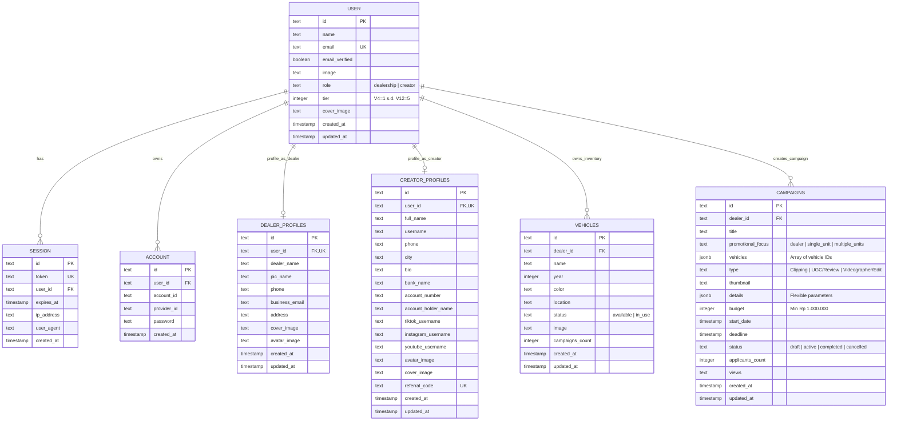

# Skema Basis Data & Model Data (Database Reference)

Dokumen ini memaparkan rancangan basis data relasional platform **CARPAIGN**, diagram relasi entitas (*Entity-Relationship Diagram / ERD*), tipe data Drizzle ORM, serta struktur payload JSONB yang fleksibel.

---

## 1. Konfigurasi Basis Data & Driver

Basis data menggunakan **PostgreSQL 15+** yang di-host pada infrastruktur cloud **Supabase** dan dikelola menggunakan **Drizzle ORM v0.40+**.

* **Koneksi Pooler**: Menggunakan Supabase Transaction Mode Pooler pada port `6543` untuk mengoptimalkan koneksi serverless Next.js tanpa lonjakan kuota koneksi (*exhausted pool*).
* **Driver**: `postgres` (porsager/postgres) dengan konfigurasi `prepare: false` untuk kompatibilitas penuh dengan connection pooling.
* **Migrasi**: Dikelola secara deklaratif menggunakan `drizzle-kit push`.

---

## 2. Diagram Relasi Entitas (Entity-Relationship Diagram)



---

## 3. Kamus Data Tabel (*Data Dictionary*)

### 3.1 Tabel `user` (Otentikasi Utama)
Menyimpan identitas dasar seluruh aktor dalam ekosistem platform.

| Nama Kolom | Tipe Data | Keterangan & Batasan |
| :--- | :--- | :--- |
| `id` | `TEXT (PK)` | Identifier unik UUID v4 yang dihasilkan sistem otentikasi. |
| `name` | `TEXT` | Nama lengkap atau nama pengguna saat pendaftaran (*not null*). |
| `email` | `TEXT (UK)` | Alamat surel aktif yang digunakan untuk login (*unique, not null*). |
| `email_verified` | `BOOLEAN` | Status verifikasi email (default: `false`). |
| `image` | `TEXT` | URL foto profil dari penyimpanan Supabase. |
| `role` | `TEXT` | Peran pengguna: `"dealership"` atau `"creator"` (default: `"creator"`). |
| `tier` | `INTEGER` | Peringkat tier mesin kreator (1=V4, 2=V6, 3=V8, 4=V10, 5=V12). |
| `cover_image` | `TEXT` | URL gambar sampul profil. |
| `created_at` | `TIMESTAMP` | Waktu pembuatan akun (*defaultNow*). |
| `updated_at` | `TIMESTAMP` | Waktu pembaruan akun terakhir (*auto-update*). |

---

### 3.2 Tabel `vehicles` (Inventaris Mobil Showroom)
Menyimpan data fisik kendaraan milik showroom yang siap dijadikan materi kampanye konten.

| Nama Kolom | Tipe Data | Keterangan & Batasan |
| :--- | :--- | :--- |
| `id` | `TEXT (PK)` | UUID v4 unik unit kendaraan. |
| `dealer_id` | `TEXT (FK)` | Relasi ke `user.id` pemilik dealer (*onDelete: cascade*). |
| `name` | `TEXT` | Merek dan tipe mobil (contoh: *"Honda HR-V 1.5 RS Turbo"*). |
| `year` | `INTEGER` | Tahun perakitan kendaraan (contoh: `2023`). |
| `color` | `TEXT` | Warna fisik eksterior mobil (contoh: *"Ignite Red Metallic"*). |
| `location` | `TEXT` | Lokasi fisik showroom tempat unit terparkir (contoh: *"Bandung Barat"*). |
| `status` | `TEXT` | Status ketersediaan: `"available"` (siap) atau `"in_use"` (sedang dipinjam/syuting). |
| `image` | `TEXT` | URL foto unit kendaraan beresolusi tinggi. |
| `campaigns_count`| `INTEGER` | Jumlah akumulasi kampanye yang menggunakan unit ini (default: `0`). |
| `created_at` | `TIMESTAMP` | Waktu unit didaftarkan ke sistem. |
| `updated_at` | `TIMESTAMP` | Waktu pembaruan status unit. |

---

### 3.3 Tabel `campaigns` (Manajemen Kampanye Pemasaran)
Menyimpan seluruh spesifikasi order kampanye digital yang diterbitkan oleh dealer.

| Nama Kolom | Tipe Data | Keterangan & Batasan |
| :--- | :--- | :--- |
| `id` | `TEXT (PK)` | UUID v4 unik kampanye. |
| `dealer_id` | `TEXT (FK)` | Relasi ke `user.id` dealer pembuat (*onDelete: cascade*). |
| `title` | `TEXT` | Judul kampanye (contoh: *"UGC Honda Brio RS Urban Challenge"*). |
| `promotional_focus`| `TEXT` | Fokus: `"dealer"` (showroom umum), `"single_unit"`, atau `"multiple_units"`. |
| `vehicles` | `JSONB` | Array berisi daftar ID kendaraan yang ditautkan (`["veh-1", "veh-2"]`). |
| `type` | `TEXT` | Jenis kampanye: `"Clipping"`, `"UGC/Review"`, atau `"Videographer/Edit"`. |
| `thumbnail` | `TEXT` | Gambar cover kartu promosi kampanye. |
| `details` | `JSONB` | **Payload JSONB Dinamis** (lihat rincian struktur di bawah). |
| `budget` | `INTEGER` | Nilai komitmen bujet dalam Rupiah (validasi minimal: Rp 1.000.000). |
| `start_date` | `TIMESTAMP` | Tanggal kampanye mulai berjalan. |
| `deadline` | `TIMESTAMP` | Batas akhir submisi draf video oleh kreator. |
| `status` | `TEXT` | Status: `"draft"`, `"active"`, `"completed"`, `"cancelled"`. |
| `applicants_count`| `INTEGER` | Jumlah kreator yang telah mendaftar kampanye ini. |
| `views` | `TEXT` | Akumulasi metrik tayangan terverifikasi (contoh: `"245.8K"`). |
| `created_at` | `TIMESTAMP` | Waktu pembuatan kampanye. |
| `updated_at` | `TIMESTAMP` | Waktu revisi kampanye. |

---

### 3.4 Struktur Payload Fleksibel `campaigns.details` (JSONB)

Karena setiap format kampanye (Clip, UGC, Shoot) memiliki parameter instruksi yang berbeda, kolom `details` dirancang fleksibel menggunakan PostgreSQL `jsonb`:

```typescript
// 1. Payload untuk Tipe "Clipping"
interface ClippingDetailsPayload {
  thumbnail?: string | null;
  description: string;
  audienceRegion: string;          // contoh: "Jabodetabek & Bandung"
  publishPlatforms: string[];      // contoh: ["TikTok", "Instagram Reels"]
  sourceMaterial: string;          // Tautan Google Drive materi mentah
  contentGuidelines: string;       // Panduan gaya pemotongan
  mandatoryPoints: string;         // Keunggulan mobil yang wajib disebut
  videoSpecs: string;              // contoh: "Vertikal 9:16, maks 60s"
  captionHashtagTags: string;      // Tagar resmi kampanye
  cta: string;                     // Ajakan bertindak (Link WhatsApp)
  forbiddenContent: string;        // Hal yang dilarang (misal: balap liar)
  cpm: number;                     // Tarif per 1.000 views valid (contoh: 15000)
  maxViewsPerClipper: number;      // Batas klaim views per kreator (contoh: 100000)
  viewsCalculationPeriod: number;  // Durasi audit views (contoh: 7 hari)
}

// 2. Payload untuk Tipe "UGC/Review"
interface UgcDetailsPayload {
  thumbnail?: string | null;
  description: string;
  productionMode: "on_site" | "remote_pickup";
  scriptOutline: string;           // Garis besar alur cerita
  keySellingPoints: string[];      // Fitur unggulan (kenyamanan kabin, efisiensi BBM)
  usageRightsDuration: string;     // Lisensi komersial (contoh: "12 Bulan")
  fixedFeePerVideo: number;        // Honor dasar video (contoh: 500000)
  performanceBonusCpm?: number;    // Bonus performa per view
}

// 3. Payload untuk Tipe "Videographer/Edit" (Shoot)
interface VideographyDetailsPayload {
  thumbnail?: string | null;
  locationDetails: string;         // Alamat showroom spesifik sesi syuting
  requiredGear: string[];          // Standar kamera (Sony A7 IV, Gimbal, Lighting)
  deliverables: {
    resolution: "4K" | "1080p";
    colorGraded: boolean;
    photoCount: number;            // contoh: 15 foto katalog
    videoDurationSeconds: number;  // contoh: 60 detik sinematik
  };
}
```

---

### 3.5 Tabel Profil Ekstensi (`dealer_profiles` & `creator_profiles`)

Kedua tabel ini terhubung secara relasional `1-to-1` dengan tabel `user`:

* **`dealer_profiles`**: Menyimpan identitas legalitas showroom, nama *Person in Charge* (PIC), nomor kontak operasional WhatsApp showroom, surel bisnis, dan alamat showroom fisik.
* **`creator_profiles`**: Menyimpan data portofolio publik kreator, kota domisili, biografi singkat, akun bank untuk penarikan dana (*bank_name, account_number, account_holder_name*), tautan akun media sosial (TikTok, Instagram, YouTube), serta **`referral_code`** unik untuk pelacakan atribusi calon pembeli.

