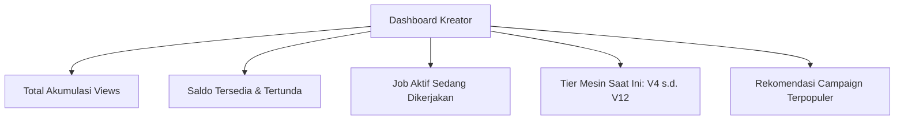
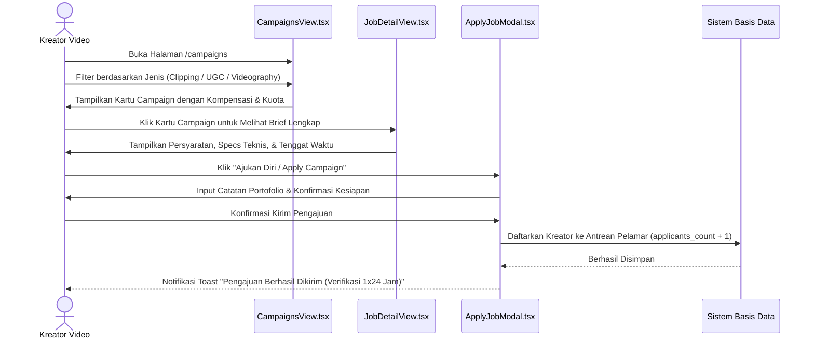
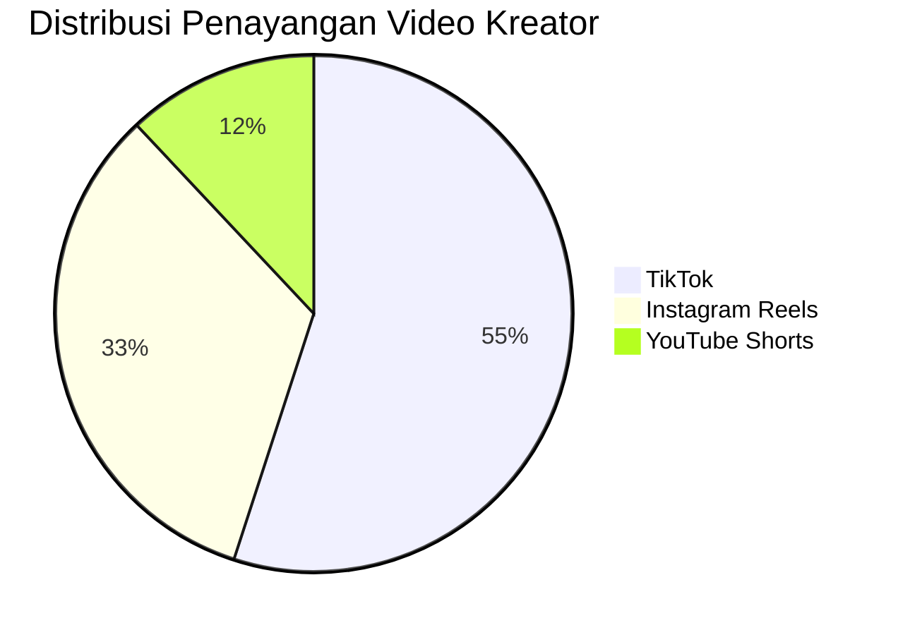
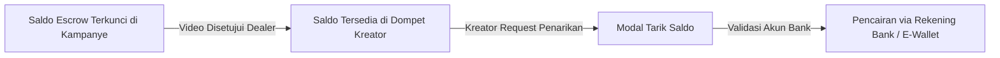

# Fitur Portal Kreator (Creator Operations, Jobs & Rewards)

Portal Kreator (`/creator/*`) adalah lingkungan kerja digital bagi para pembuat konten video pendek (*clippers*, *UGC creators*, videografer otomotif) untuk menemukan peluang kerja komersial yang terverifikasi, memantau metrik performa video, mengelola penghasilan, dan menaikkan level reputasi kerja.

---

## 1. Dashboard Utama Kreator (`/creator/dashboard`)

Halaman ikhtisar yang menyajikan metrik performa esensial bagi kreator:

### Komponen Kunci Dashboard Kreator:
* **Statistik Cepat**: Menampilkan total *views* yang terkumpul dari seluruh video aktif, total pendapatan yang telah disetujui, serta jumlah pengajuan job yang sedang ditinjau dealer.
* **Status Badge & Tier Engine**: Menampilkan lencana mesin (contoh: **V6 Class**) lengkap dengan bilah progres jumlah job menuju kenaikan tier berikutnya.
* **Jadwal & Deadline Mendatang**: Kartu pengingat tenggat waktu penyerahan draf video agar kreator tidak terkena penalti wanprestasi (*deadline breach*).

---

## 2. Marketplace Kampanye & Alur Pelamaran Job (`/creator/campaigns`)

Katalog eksplorasi lowongan kampanye promosi otomotif yang dapat difilter berdasarkan jenis pekerjaan dan preferensi lokasi.

### Fitur Penjelajahan Kampanye:
1. **Filter Kategori Cepat**:
   * *Semua*: Menampilkan seluruh format pekerjaan.
   * *Clipping*: Pekerjaan remote mengedit cuplikan video mentah showroom.
   * *UGC / Review*: Pekerjaan produksi video ulasan POV dengan unit mobil fisik.
   * *Videographer / Edit*: Pekerjaan pengambilan gambar sinematik on-site di showroom.
2. **Carousel Kampanye Unggulan (*Featured Campaigns*)**: Slider otomatis (*Embla Carousel Autoplay*) yang menyorot kampanye dengan alokasi kompensasi tertinggi.
3. **Detail Lembar Kerja (*Job Sheet*)**: Menyajikan rincian spesifikasi rasio aspek (9:16 vs 16:9), format berkas (ProRes/H.265/MP4), resolusi minimal (4K/1080p), panduan naskah, dan daftar larangan konten (*forbidden items*).

---

## 3. Analitik Kinerja & Grafik Penayangan (`/creator/analitik`)

Menyediakan transparansi data penayangan video secara multi-platform.

* **Grafik Kinerja Interaktif (`PerformanceChart.tsx`)**: Menampilkan kurva pertumbuhan *views* harian dan mingguan menggunakan SVG line chart kustom dengan gradien emas.
* **Audit Views & Deteksi Anomali**: Sistem mengeliminasi penayangan dari akun bot/palsu sehingga kreator dibayar murni berdasarkan tayangan nyata yang terverifikasi.
* **Metrik Komparasi Platform**: Mengetahui platform mana yang menghasilkan interaksi calon pembeli paling tinggi bagi showroom mitra.

---

## 4. Dompet Kreator & Penarikan Dana (`/creator/pendapatan`)

CARPAIGN menjamin kepastian pembayaran tanpa friksi birokrasi:

### Fitur Dompet Kreator:
* **Pemisahan Saldo Jelas**:
  * *Saldo Tersedia*: Dana yang sudah selesai diaudit dan siap ditarik ke rekening kapan saja.
  * *Saldo Tertunda (*Pending Escrow*)*: Dana dari kampanye yang videonya sedang direview oleh dealer.
* **Modal Penarikan Dana (`WithdrawModal.tsx`)**:
  * Menampilkan informasi bank tujuan (BCA, Mandiri, BRI, BNI, Bank Jago).
  * Menghitung potongan biaya transfer dan estimasi waktu tiba (reguler 3–5 hari untuk tier V4, atau ekspres 1 hari untuk tier V6 ke atas).
* **Riwayat Penerimaan Transaksi**: Mencatat riwayat pembayaran honor per video lengkap dengan ID transaksi dan bukti transfer digital.

---

## 5. Sistem Reputasi & Tier Hadiah Mesin Otomotif (`/creator/rank-rewards`)

Untuk mendorong reliabilitas dan profesionalisme kerja tanpa memandang jumlah pengikut media sosial (*follower-agnostic*), CARPAIGN memperkenalkan **Tier Engine System**:

| Tier Lencana | Syarat Capaian Job | Potongan Platform | Keuntungan Tambahan |
| :---: | :---: | :---: | :--- |
| **V4 Class** | 0 – 10 Job Selesai | 15% | Akses job dasar, pencairan dana reguler (3–5 hari kerja). |
| **V6 Class** | 11 – 50 Job Selesai | 10% | Akses job UGC Premium, pencairan dana ekspres (1 hari kerja). |
| **V8 Class** | 51 – 100 Job Selesai | 8% | Prioritas listing profil ke dealer, bonus insentif views. |
| **V10 Class** | 101 – 250 Job Selesai | 5% | Direct booking dealer tanpa antrean kurasi, VIP fast-support. |
| **V12 Class** | >250 Job Selesai | **3%** | Lencana Elite Creator, akses eksklusif kampanye mobil sport & mewah. |

---

## 6. Papan Peringkat Kreator (`/creator/leaderboard`)

Mekanisme gamifikasi kompetitif yang menyajikan peringkat kreator terbaik:
* **Filter Periode**: Pilihan antara *Bulan Ini* (*Monthly Leaderboard*) dan *Sepanjang Masa* (*All-Time Champions*).
* **Kategori Peran**: Peringkat terpisah untuk **Kreator UGC/Video** dan **Clipper Konten Pendek**.
* **Indikator Tren**: Menampilkan panah hijau (naik peringkat), panah merah (turun), atau stabil (*same*) berdasarkan perolehan views mingguan.

