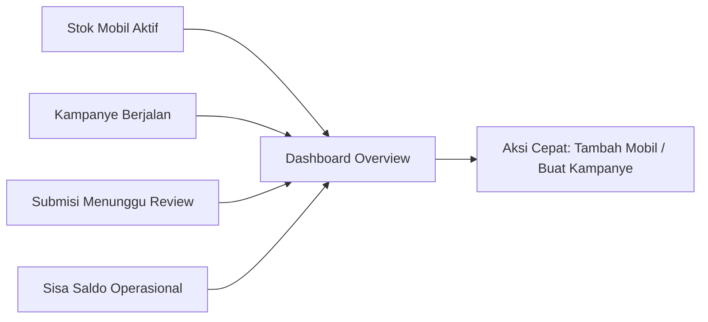
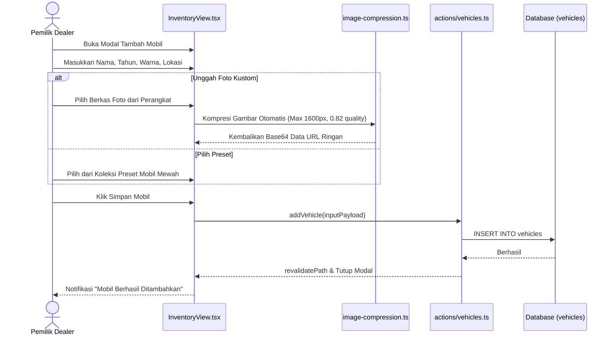
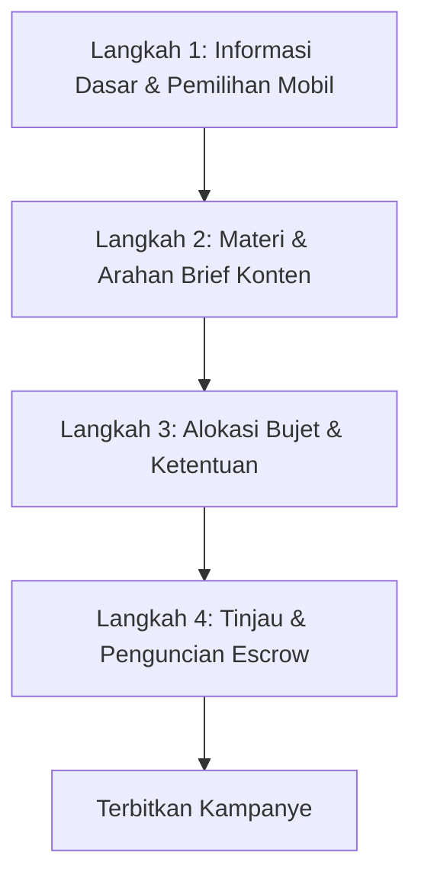
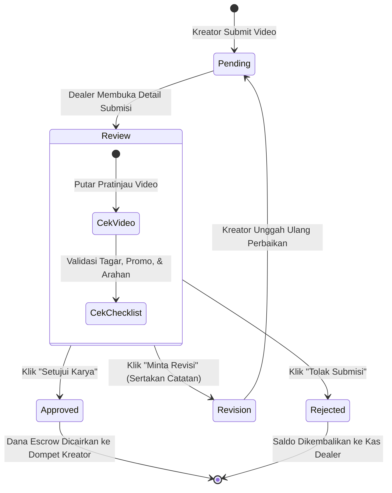

# Fitur Portal Dealer (Dealership Operations & Management)

Portal Dealer (`/dealer/*`) merupakan pusat komando operasional bagi pemilik dan pengelola showroom mobil bekas untuk mendigitalisasi stok kendaraan fisik, merancang kampanye promosi terukur, mengevaluasi hasil karya kreator, dan mengelola arus kas periklanan.

---

## 1. Dashboard Utama Dealer (`/dealer/dashboard`)

Halaman ringkasan operasional harian yang menyajikan indikator performa utama (*KPI*) dalam format kartu modern:

### Indikator Utama yang Ditampilkan:
1. **Total Stok Inventaris**: Jumlah total kendaraan yang terdaftar di showroom beserta rincian unit yang sedang tersedia (*available*) vs sedang digunakan syuting (*in_use*).
2. **Kampanye Aktif**: Menampilkan jumlah kampanye yang sedang berjalan dan tenggat waktunya.
3. **Submisi Menunggu Tindakan (*Pending Submissions*)**: Notifikasi jumlah draf video dari kreator yang perlu segera direview agar tidak melewati batas evaluasi otomatis (3x24 jam).
4. **Saldo Dompet Dealer**: Saldo riil yang tersedia untuk mengalokasikan kampanye baru.
5. **Grafik Metrik Penayangan**: Menampilkan performa views organik dari kampanye Clip dan UGC yang telah terverifikasi.

---

## 2. Sistem Manajemen Inventaris Mobil (`/dealer/inventory`)

Modul ini berfungsi sebagai *Single Source of Truth* seluruh armada mobil fisik di showroom.

### Fitur-Fitur Kunci Inventaris:
* **Penambahan Mobil Mudah**: Mendukung penentuan nama model, tahun pembuatan, warna eksterior, lokasi fisik showroom, dan foto kendaraan.
* **Katalog Preset Foto Siap Pakai**: Menyediakan puluhan foto kendaraan profesional beresolusi tinggi (SUV, Sedan Mewah, Hatchback) untuk showroom yang belum sempat memotret unitnya.
* **Toggle Status Unit**: Mengubah status dari *"Tersedia"* (`available`) menjadi *"Sedang Dipakai"* (`in_use`) saat unit sedang dipinjam kreator untuk syuting on-site, mencegah tumpang tindih jadwal.
* **Penghitung Utilisasi Kampanye**: Menghitung secara otomatis berapa kali sebuah mobil telah dijadikan materi kampanye (`campaigns_count`), membantu mengidentifikasi unit yang butuh dorongan promosi ulang (*re-campaign*).

---

## 3. Wizard Pembuatan Kampanye 4-Tahap (`/dealer/campaigns`)

Dealer dapat menerbitkan kampanye dalam 3 format modular melalui formulir terpandu 4 langkah:

### Format 1: Clipping Campaign (`ClippingCampaignForm.tsx`)
* **Tujuan**: Memperoleh jangkauan penonton seluas-luasnya (*viral awareness*) di TikTok/Reels dengan mendistribusikan video mentah showroom ke ratusan *clipper*.
* **Parameter Unik**:
  * *Tautan Materi Mentah*: URL Google Drive materi video showroom.
  * *Model Biaya*: **CPM (Cost Per Mille)** — tarif per 1.000 views valid (contoh: Rp 15.000/1k views).
  * *Batas Klaim per Clipper*: Maksimal views yang dapat diklaim per akun (mencegah monopoli bujet).
  * *Periode Perhitungan*: Jangka waktu audit penayangan (contoh: 7 hari pasca-unggah).

### Format 2: UGC / Review Campaign (`UgcCampaignForm.tsx`)
* **Tujuan**: Membangun kepercayaan calon pembeli melalui ulasan jujur mengenai kenyamanan berkendara, fitur interior, dan simulasi cicilan kredit.
* **Parameter Unik**:
  * *Mode Produksi*: Pilihan antara hadir langsung ke showroom (*on-site visit*) atau penyerahan unit sementara.
  * *Struktur Biaya*: Honor tetap per video disetujui (contoh: Rp 500.000) ditambah insentif bonus views.
  * *Hak Cipta*: Pengalihan otomatis hak lisensi komersial ke dealer selama 6–12 bulan.

### Format 3: Videography / Shoot Campaign (`VideographyCampaignForm.tsx`)
* **Tujuan**: Menghasilkan aset visual permanen berupa 15 foto katalog resolusi tinggi dan 1 video sinematik 60 detik untuk mempercantik etalase showroom.
* **Parameter Unik**:
  * *Jadwal & Lokasi Showroom*: Waktu pelaksanaan sesi syuting fisik.
  * *Standar Peralatan Kreator*: Wajib kamera mirrorless minimal 4K (Sony A7 series), gimbal stabilizer, dan perangkat audio nirkabel.
  * *Luaran Berkas*: Format ProRes/H.265 dengan master color-graded.

---

## 4. Evaluasi Submisi & Pelepasan Dana Escrow (`/dealer/submissions`)

Ketika kreator mengunggah hasil karya video, draf akan masuk ke panel peninjauan dealer sebelum video tayang di media sosial publik.

### Komponen Pemeriksaan Submisi:
1. **Pemutar Video Terintegrasi**: Memutar video vertikal 9:16 langsung di dalam peramban tanpa perlu mengunduh berkas mentah.
2. **Checklist Panduan Kampanye**: Memverifikasi pemenuhan kriteria wajib (misal: "Menyebutkan DP ringan", "Menampilkan interior mobil", "Menyertakan tagar resmi").
3. **Pemberian Catatan Revisi**: Dealer dapat memberikan instruksi spesifik (contoh: *"Tolong pertegas suara voice-over di detik ke-15 saat membahas garansi mesin"*).

---

## 5. Billing & Pengelolaan Saldo Escrow (`/dealer/billing`)

CARPAIGN menerapkan transparansi finansial penuh bagi pengusaha dealer:

* **Saldo Aktif**: Dana likuid yang dapat ditarik atau dialokasikan ke kampanye baru.
* **Saldo Terkunci (*Reserved in Escrow*)**: Dana yang sedang dipegang oleh sistem sebagai jaminan pembayaran untuk kampanye yang sedang dikerjakan oleh para kreator.
* **Simulasi Top-Up Virtual Account (`TopUpModal.tsx`)**:
  * Mendukung simulasi instan penambahan saldo via BCA, Mandiri, BNI, dan BRI Virtual Account.
  * Dana langsung tercermin di dashboard dealer secara *real-time* setelah simulasi konfirmasi pembayaran.
* **Riwayat Mutasi Transaksi**: Tabel pencatatan seluruh pengeluaran promosi per unit mobil, biaya langganan SaaS, dan tanda terima berstempel digital.

