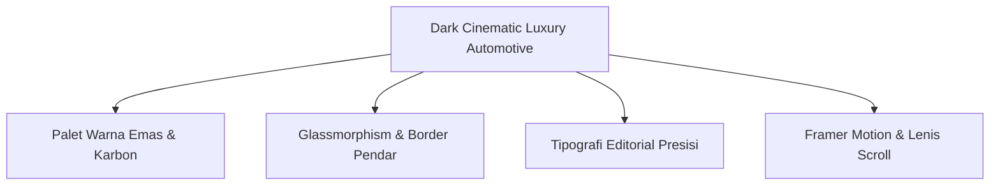
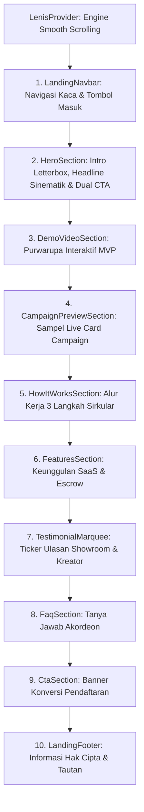

# Landing Page & Sistem Desain (Design System & UI Architecture)

Dokumen ini menjelaskan arsitektur antarmuka pengguna (*User Interface / UI*), komponen Landing Page sinematik, sistem desain (*Design System*) bernuansa kemewahan otomotif (*Dark Cinematic Luxury Automotive*), serta rekayasa animasi interaktif pada platform **CARPAIGN**.

---

## 1. Filosofi Desain: *Dark Cinematic Luxury Automotive*

Antarmuka CARPAIGN dirancang dengan standar estetika tinggi setara pemenang penghargaan desain global (*Awwwards / FWA*). Menghindari tampilan dashboard template generik, CARPAIGN menggunakan tema gelap pekat beraksen emas cair (*Liquid Luxury Gold*) yang mencerminkan aura prestisius industri otomotif kelas atas:



### Palet Warna Inti (*Core Palette*):
* **Background Utama**: `Luxury Black` (`#09090b` / `bg-zinc-950`) — memberikan kontras maksimal tanpa membuat mata lelah.
* **Warna Aksen Utama**: `Liquid Luxury Gold` (`#C5A880` / `var(--primary)`) — menyimbolkan nilai komersial bernilai tinggi dan eksklusivitas.
* **Pendar Emas (*Primary Glow*)**: `rgba(197, 168, 128, 0.25)` — digunakan pada efek sorotan (*spotlight*) dan hover tombol interaktif.
* **Surface Card**: `Zinc 900/60` dengan efek kaca transparan (*Glassmorphism*) dan efek buram latar belakang (`backdrop-blur-md`).
* **Border Garis**: Garis tipis 1 piksel semi-transparan (`border-white/10` atau `border-primary/20`) untuk mendefinisikan struktur kartu secara elegan.

---

## 2. Arsitektur Komponen Landing Page (`src/components/landing/`)

Halaman utama (`src/app/page.tsx` memanggil `LandingView.tsx`) merupakan instrumen konversi pemasaran yang menyatukan 10 seksi interaktif:



### Penjelasan Rinci Setiap Seksi:

1. **`LandingNavbar.tsx`**:
   * Header mengambang (*floating navbar*) dengan latar belakang kaca buram (*glassmorphic header*).
   * Menampilkan logo CARPAIGN, tautan navigasi seksi, dan tombol masuk portal (*Login / Buka Dashboard*).

2. **`HeroSection.tsx`**:
   * Membuka halaman dengan efek sinematik berbingkai *letterbox*.
   * Menyajikan judul proposisi nilai: *"Turn Vehicle Inventory Into Content, and Content into Sales"*.
   * Menyediakan dua tombol aksi utama: *"Mulai Sebagai Dealer"* (arah ke pendaftaran showroom) dan *"Jelajahi Campaign"* (arah ke katalog kreator).

3. **`DemoVideoSection.tsx`**:
   * Menampilkan demonstrasi video atau purwarupa interaktif produk (*Product Tour*).
   * Memberikan bukti nyata bentuk antarmuka platform sebelum pengguna mendaftar.

4. **`CampaignPreviewSection.tsx`**:
   * Menampilkan kartu-kartu kampanye nyata (Clip, UGC, Shoot) dengan foto mobil resolusi tinggi, nominal kompensasi Rupiah, dan lencana format promosi.

5. **`HowItWorksSection.tsx`**:
   * Menjelaskan alur sirkular sistem dalam 3 langkah mudah:
     * *Langkah 1*: Showroom mendaftarkan inventaris & menetapkan bujet promosi.
     * *Langkah 2*: Kreator terverifikasi memproduksi konten video kreatif.
     * *Langkah 3*: Konten disebar, calon pembeli menghubungi via WhatsApp, dan dana escrow dicairkan.

6. **`FeaturesSection.tsx`**:
   * Merinci fitur unggulan seperti perlindungan dana *Escrow Ledger*, pelacakan prospek *Closed-Loop WhatsApp*, dan *Inventory SaaS Engine*.

7. **`TestimonialMarquee.tsx`**:
   * *Infinite scrolling ticker* horizontal berkecepatan konstan yang menampilkan testimoni dari pemilik showroom dan kreator otomotif muda.

8. **`FaqSection.tsx`**:
   * Komponen akordeon interaktif (*Radix UI Accordion*) yang menjawab keraguan seputar keamanan pembayaran, durasi pengerjaan, dan legalitas hak cipta video komersial.

9. **`CtaSection.tsx` & `LandingFooter.tsx`**:
   * Ajakan bertindak penutup dengan pendar emas yang kuat untuk mendorong konversi pendaftaran, dilengkapi informasi almamater Universitas Telkom.

---

## 3. Rekayasa Animasi (*Motion & Physics*)

Semua animasi interaktif diatur secara deklaratif menggunakan **Framer Motion**:

### Varian Motion Standar (`fadeUp`):
```typescript
export const fadeUp: Variants = {
  hidden: { opacity: 0, y: 16 },
  show: (i: number) => ({
    opacity: 1,
    y: 0,
    transition: {
      delay: i * 0.05,
      duration: 0.45,
      ease: [0.16, 1, 0.3, 1], // Kurva easing premium khas Apple / Awwwards
    },
  }),
};
```

### Integrasi Lenis Smooth Scroll:
```typescript
// src/components/landing/LenisProvider.tsx
export function LenisProvider({ children }: { children: React.ReactNode }) {
  useEffect(() => {
    const lenis = new Lenis({
      duration: 1.2,
      easing: (t) => Math.min(1, 1.001 - Math.pow(2, -10 * t)),
      smoothWheel: true,
    });

    function raf(time: number) {
      lenis.raf(time);
      requestAnimationFrame(raf);
    }

    requestAnimationFrame(raf);
    return () => lenis.destroy();
  }, []);

  return <>{children}</>;
}
```
* Efek ini mengeliminasi *scroll-stutter* dan memberikan sensasi kelembutan gulir halaman pada layar ber-refresh rate tinggi (120Hz ProMotion).

